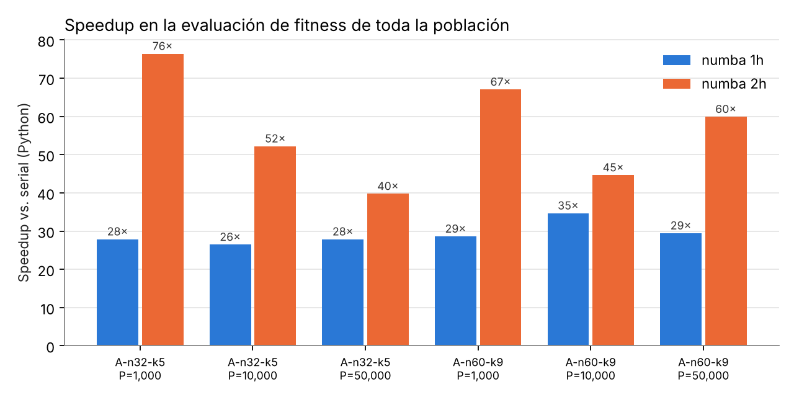
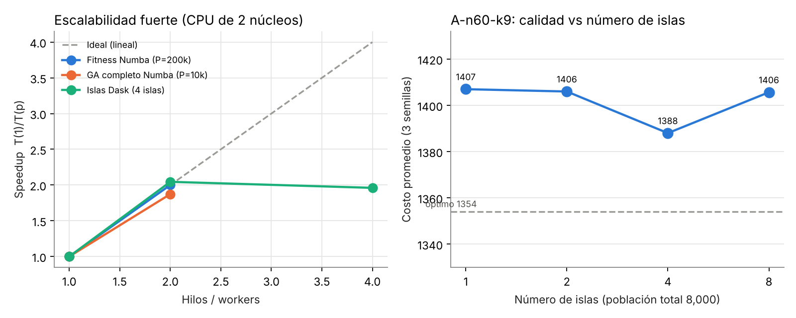
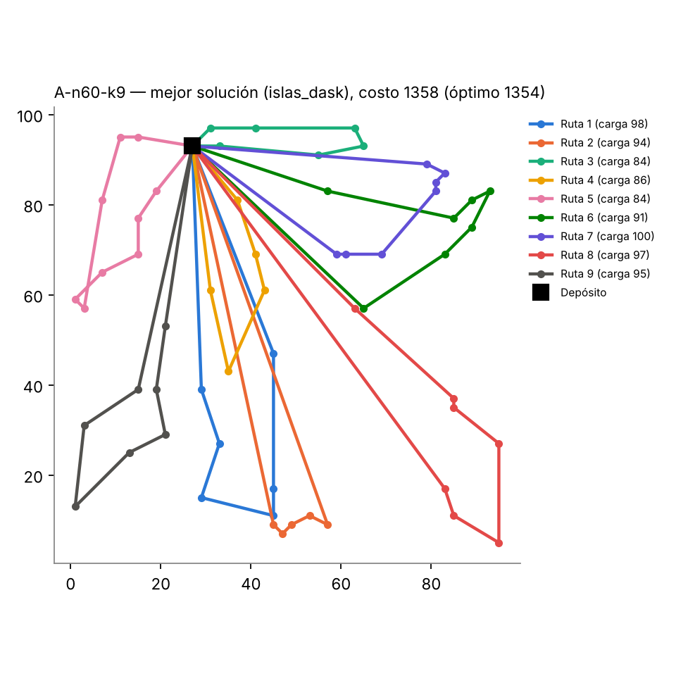

# Informe de pruebas — CVRP con GA paralelo

## 1. Entorno y metodología

| Elemento | Valor |
|---|---|
| CPU | Intel Xeon @ 2.10 GHz, **2 núcleos físicos** (1 hilo por núcleo) |
| GPU | No disponible (CUDA validado con el simulador de Numba; ver §6) |
| Software | Python 3.13, Numba 0.68, Dask 2026.8, NumPy, CUDA Toolkit 13.4 (nvcc) |
| Instancias | Augerat A-n32-k5 (31 clientes, K=5, óptimo **784**) y A-n60-k9 (59 clientes, K=9, óptimo **1354**) |
| Scripts | `bench_fitness.py`, `bench_ga.py`, `bench_scaling.py` (resultados CSV en `benchmarks/results/`) |

**Medición.** Los tiempos de fitness son el mínimo (escalabilidad) o la mediana (comparación de enfoques)
de 7–15 repeticiones después de una corrida de calentamiento, para excluir la compilación JIT.
Las corridas del GA completo se repiten con 2–5 semillas y se reporta mejor valor y promedio.

**Métricas.**

* Speedup: S(p) = T(referencia) / T(p)
* Eficiencia (fuerte): E(p) = S(p) / p, con p = hilos o workers. Ideal = 1.
* Eficiencia débil: E_w(p) = T(1) / T(p) con carga por hilo constante. Ideal = 1.
* **Métrica de calidad del rubro (logística):** gap respecto al óptimo conocido,
  gap = (costo − óptimo) / óptimo × 100, con costo = distancia total de las rutas factibles.

**Validación de correctitud.** Los tres evaluadores (Python, Numba, kernel CUDA en simulador)
devuelven exactamente los mismos valores para 200 individuos aleatorios en ambas instancias, y la
solución óptima publicada de A-n32-k5 se decodifica a 784.0 con cargas ≤ 100 en las cinco rutas.

## 2. Speedup en la evaluación de fitness

Evaluación de toda la población (mediana de 7 repeticiones; `fitness.csv`):

| Instancia | Población | Serial Python | Numba 1 hilo | Numba 2 hilos | S Numba 1h | S Numba 2h |
|---|---:|---:|---:|---:|---:|---:|
| A-n32-k5 | 1,000 | 2.41 ms | 0.086 ms | 0.032 ms | 28× | 76×* |
| A-n32-k5 | 10,000 | 26.1 ms | 0.99 ms | 0.50 ms | 26× | 52× |
| A-n32-k5 | 50,000 | 141.8 ms | 5.09 ms | 3.57 ms | 28× | 40× |
| A-n60-k9 | 1,000 | 5.01 ms | 0.175 ms | 0.075 ms | 29× | 67×* |
| A-n60-k9 | 10,000 | 64.7 ms | 1.87 ms | 1.45 ms | 35× | 45× |
| A-n60-k9 | 50,000 | 271.3 ms | 9.21 ms | 4.53 ms | 29× | 60× |

\* Con 1,000 individuos los tiempos son de decenas de microsegundos y el ruido domina.

Dentro del GA completo (P = 10,000, 300 generaciones), el tiempo acumulado de fitness pasa de
**16.81 s (serial) a 0.28 s (Numba)** en A-n60-k9 (**60×**) y de 9.31 s a 0.15 s en A-n32-k5 (**64×**).



**Lectura.** El speedup total se descompone en dos factores: ~30× por compilar (Numba 1 hilo vs Python
interpretado, mismo algoritmo) y ~2× por paralelismo (2 núcleos). La referencia del enunciado
(6–8× en CPU, ~30× en GPU) mide sólo el factor paralelo sobre código compilado y con más núcleos;
nuestro factor paralelo (2.0× con 2 núcleos) es el máximo posible en esta máquina.

## 3. Eficiencia y escalabilidad

### 3.1 Escalabilidad fuerte (problema fijo, más hilos/workers)

| Prueba | p | Tiempo | Speedup | Eficiencia |
|---|---:|---:|---:|---:|
| Fitness Numba, P = 50,000 | 1 → 2 | 8.91 → 4.31 ms | 2.07 | 1.03 |
| Fitness Numba, P = 200,000 | 1 → 2 | 36.9 → 18.4 ms | 2.00 | 1.00 |
| GA completo Numba, P = 10,000, 100 gen. | 1 → 2 | 2.32 → 1.24 s | 1.87 | 0.94 |
| Islas Dask, 4 islas, P = 8,000, 300 gen. | 1 → 2 workers | 4.10 → 2.01 s | 2.04 | 1.02 |
| Islas Dask, 4 islas | 2 → 4 workers | 2.01 → 2.09 s | 1.96 (vs 1) | 0.98 (sobre 2 núcleos) |

### 3.2 Escalabilidad débil (100,000 individuos por hilo)

| Hilos | Población | Tiempo | Eficiencia débil |
|---:|---:|---:|---:|
| 1 | 100,000 | 18.3 ms | 1.00 |
| 2 | 200,000 | 18.7 ms | 0.98 |



**Análisis.**

* La evaluación de fitness es *embarrassingly parallel*: cada individuo es independiente, no hay
  sincronización salvo al final del `prange`, y la matriz de distancias (60×60) cabe en caché.
  Por eso la eficiencia es ≈ 1.0 tanto fuerte como débil.
* El GA completo baja a 0.94 porque quedan partes seriales: copiar la élite, `argpartition`
  para seleccionar los mejores y el armado de la nueva población. Con la ley de Amdahl,
  S(2) = 1.873 implica una fracción paralela f ≈ 0.93. Eso predice ~5.4× con 8 núcleos y un
  máximo teórico de ~14.7× con núcleos ilimitados.
* En la versión serial el fitness ocupa el 75 % del tiempo del GA (16.8 de 22.4 s). Si sólo se
  paralelizara el fitness, Amdahl limitaría el speedup del GA a 4×. Por eso también se paralelizó
  la generación de descendencia (torneo + OX + mutación + 2-opt) con `prange`. El resultado es un
  GA completo **7.1× más rápido** que el serial (22.4 s → 3.15 s).
* Islas: con 4 islas y 2 núcleos, pasar de 1 a 2 workers duplica la velocidad (las islas no se
  comunican durante una época). Usar 4 workers en 2 núcleos ya no ayuda (sobresuscripción).
  La migración cuesta poco: sólo se intercambian 5 individuos por isla cada 100 generaciones.

## 4. Calidad de la solución (gap)

**P = 10,000, 300 generaciones, 2 semillas** (`ga_p10000.csv`):

| Instancia | Enfoque | Mejor costo | Gap mejor | Costo prom. | Gap prom. | Tiempo total | Tiempo fitness |
|---|---|---:|---:|---:|---:|---:|---:|
| A-n32-k5 | Serial | 784 | 0.00 % | 790.0 | 0.77 % | 13.34 s | 9.31 s |
| A-n32-k5 | Numba | 784 | 0.00 % | 784.0 | 0.00 % | 2.25 s | 0.15 s |
| A-n32-k5 | Islas Dask (4×2,500) | 784 | 0.00 % | 784.0 | 0.00 % | 2.09 s | — |
| A-n32-k5 | CUDA | N/D | — | — | — | — | — |
| A-n60-k9 | Serial | 1415 | 4.51 % | 1417.0 | 4.65 % | 22.39 s | 16.81 s |
| A-n60-k9 | Numba | 1428 | 5.47 % | 1448.0 | 6.94 % | 3.15 s | 0.28 s |
| A-n60-k9 | Islas Dask (4×2,500) | **1358** | **0.30 %** | 1382.5 | 2.10 % | 2.90 s | — |
| A-n60-k9 | CUDA | N/D | — | — | — | — | — |

**P = 2,000, 500 generaciones, 5 semillas** (`ga_p2000.csv`):

| Instancia | Enfoque | Mejor costo | Gap mejor | Gap prom. | Tiempo total |
|---|---|---:|---:|---:|---:|
| A-n32-k5 | Serial | 796 | 1.53 % | 5.31 % | 3.53 s |
| A-n32-k5 | Numba | 784 | 0.00 % | 3.44 % | 0.67 s |
| A-n32-k5 | Islas Dask (4×500) | 784 | 0.00 % | 0.61 % | 0.71 s |
| A-n60-k9 | Serial | 1378 | 1.77 % | 4.73 % | 6.56 s |
| A-n60-k9 | Numba | 1390 | 2.66 % | 5.41 % | 0.92 s |
| A-n60-k9 | Islas Dask (4×500) | 1380 | 1.92 % | 2.94 % | 0.90 s |



**Análisis.**

* **Serial y Numba tienen calidad equivalente.** Ejecutan el mismo algoritmo; sólo cambia la
  secuencia de números aleatorios (en paralelo cada hilo tiene su propio generador). Con 5 semillas,
  los gaps promedio (4.7 % vs 5.4 %) están dentro de la variación entre semillas. Paralelizar
  no degradó la calidad, igual que en la referencia.
* **El modelo de islas sí mejora la calidad** con el mismo presupuesto (población total y
  generaciones): gap promedio de 2.9 % vs ~5 % (P = 2,000) y 2.1 % vs 4.7–6.9 % (P = 10,000).
  Cada isla converge a un óptimo local distinto y la migración combina buenas rutas de
  islas diferentes. La mejor solución encontrada (1358, a 0.30 % del óptimo) salió de las islas.
* El número de islas tiene un punto óptimo. Con P = 8,000 el mejor promedio se obtuvo con 4 islas
  (1388), frente a 1407 con 1 isla y 1406 con 8. Con 8 islas cada subpoblación (1,000) es
  demasiado chica y converge prematuramente.
* A-n32-k5 se resuelve al óptimo de forma consistente. A-n60-k9 (59 clientes, holgura de
  capacidad de sólo 8 %) es más difícil: la restricción de capacidad deja pocas soluciones factibles cerca del óptimo.

## 5. Informe SUS y comentarios

**Herramienta evaluada:** interfaz web `app.py` (Streamlit). En ella se elige la instancia (o se sube
un `.vrp`), el enfoque (serial / Numba / CUDA / islas) y los parámetros. Muestra distancia, gap, tiempos,
mapa de rutas, curva de convergencia y tabla de cargas, y permite descargar la solución.
Capturas: `docs/interfaz_numba.png`, `docs/interfaz_islas.png`.

**Procedimiento:** `sus/PROTOCOLO_SUS.md`. Incluye 5 tareas sin ayuda, el cuestionario SUS de 10 ítems
y 3 preguntas abiertas, con 5–10 participantes de perfil técnico y no técnico.

**Resultados:** *pendiente de aplicar a los participantes*. Al vaciar las respuestas en
`sus/respuestas_sus.csv` y ejecutar:

```bash
python sus/analizar_sus.py sus/respuestas_sus.csv
```

se genera `sus/resultados_sus.md` con estos elementos, que se pegan en esta sección:

* puntaje SUS por participante, promedio, desviación estándar e intervalo de confianza al 95 %;
* interpretación (adjetivo de Bangor y comparación contra el promedio de referencia de 68);
* promedio por ítem (fortalezas y áreas de mejora), comparación técnico/no técnico y tasa de éxito en tareas;
* comentarios agrupados por tema (velocidad, visualización, claridad de términos, navegación,
  parámetros, exportación, errores) con conteo de positivos, problemas y sugerencias.

**Guía para analizar los comentarios** (llenar con los datos reales):

1. ¿Qué tema concentra más problemas? Esa es la primera mejora a proponer.
2. ¿Los no técnicos puntúan mucho más bajo que los técnicos? Si es así, el problema está en la
   terminología (gap, fitness, islas, semilla), no en la navegación.
3. ¿Qué ítems SUS tienen el aporte más bajo? P4 y P10 bajos indican curva de aprendizaje;
   P6 bajo, inconsistencia; P5 bajo, que las funciones no se sienten integradas.
4. Relacionar cada comentario negativo con un cambio concreto de la interfaz.

## 6. Limitaciones de las pruebas

* **Sin GPU.** El kernel `@cuda.jit` se validó en el simulador de Numba con resultados idénticos a
  la versión serial, y `thrust_sel.cu` compila con CUDA 13.4. Aun así, no hay tiempos reales de GPU.
  `bench_fitness.py` y `bench_ga.py` agregan la columna CUDA automáticamente al detectar una GPU.
* **2 núcleos.** Las curvas de escalabilidad tienen sólo dos puntos útiles. Los scripts recorren
  automáticamente todos los núcleos disponibles, así que en una máquina con más núcleos se obtiene la curva completa.
* La variabilidad de una máquina virtual afecta mediciones de menos de 1 ms. Por eso la
  escalabilidad se midió con poblaciones grandes (≥ 50,000) y con el mínimo de 15 repeticiones.
